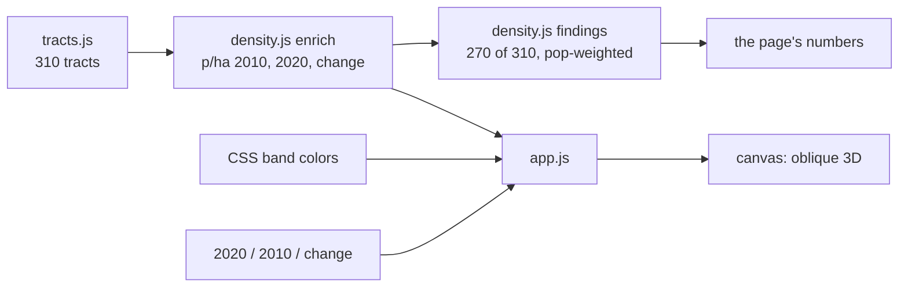

# How Manhattan Tract Density is built

A static explainer page: one HTML page, three small scripts and one data file. No framework, no bundler, no
runtime dependencies, and no 3D library: the "3D" island is an oblique projection drawn on a 2D canvas.
About 150 lines of code, 70 KB of data.

## Runtime

| Piece | What it uses |
|---|---|
| Drawing | **Canvas 2D**: tract outlines extruded by density, drawn back to front (painter's algorithm) |
| Data | `tracts.js`: 310 tracts with 2010 and 2020 population, land area and simplified outlines, inlined |
| Colors | CSS custom properties, read by the script, so the bands follow the page's light or dark theme |
| Libraries | None at runtime |

Dev only: Node's built-in test runner (data and findings), Playwright + axe-core (browser and accessibility tests).

## Files

```
index.html   the explainer: headline, dek, the canvas with its 2020 / 2010 / change switch, findings, notes
tracts.js    the data (NYC City Planning's 2010–2020 Census workbook on 2020 tracts; shapes in a local metre grid)
density.js   pure: density bands (Angel & Lamson-Hall's plate, persons per hectare), change bands,
             enrich() (densities, centers, heights) and findings() (band movers, population-weighted density)
app.js       draws the island, the legend and the findings; drag or use the Turn buttons to turn it, hover
             or tap for a tract's numbers
tests/       density.test.js (data and claims), page.test.js
e2e/         smoke and axe
```

## How it fits together



## Core techniques

- **Oblique projection by hand.** Each outline point is rotated by an azimuth, then projected:
  screen y = ground y × sin(elevation) − height × cos(elevation). A tract's height is its density, scaled so
  the 1910 peak (2,400 persons per hectare) would use 30% of the frame. Tracts are sorted by depth and drawn
  far to near (ground pass, then walls, then tops), so nearer blocks cover farther ones. Dragging sideways (mouse
  or finger) or the Turn buttons change the azimuth and redraw; hovering or tapping hit-tests the drawn tops from
  nearest to farthest (point in polygon). The canvas keeps `touch-action: pan-y`, so on a phone an up-and-down
  swipe still scrolls the page and only a sideways one turns the island.
- **Numbers on the page come from the data.** The findings ("270 of 310 tracts stay in the same band", the
  densest tract, population-weighted density 2010 → 2020) are computed by `findings()`, not typed in.
- **Checked against the sources.** Tests pin the data to the Census totals (1,585,873 in 2010 and 1,694,251 in
  2020), compare 2010 densities with Angel & Lamson-Hall's figures where their built-block definition allows,
  and check each written claim on the page.

## Testing and deploy

- `npm test`: Node's test runner on `density.js` and the data, plus a page-claims test.
- `npm run test:e2e`: Playwright at desktop and phone size: turning by button and by finger, a tap showing a
  tract's numbers inside the picture, and axe accessibility checks.
- Pushing to `main` runs both in GitHub Actions (the shared workflow in
  [csciuto/app-template](https://github.com/csciuto/app-template)); only if they pass is the site stamped with a
  version and published to GitHub Pages.

## Known limits

- Density is residents per hectare of land, by tract, not per built block as in the 1910/2010 plate, so the
  comparison holds only where the two definitions line up.
- One elevation angle (turning doesn't tilt it); outlines are simplified.
- A tract's numbers need a pointer: there is no list of tracts for a keyboard or screen reader.
